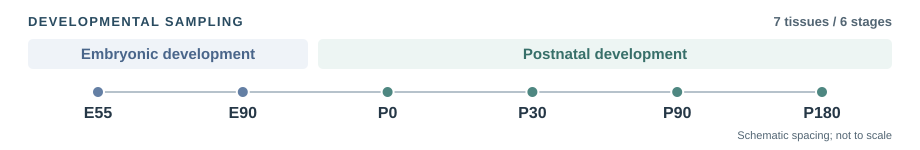
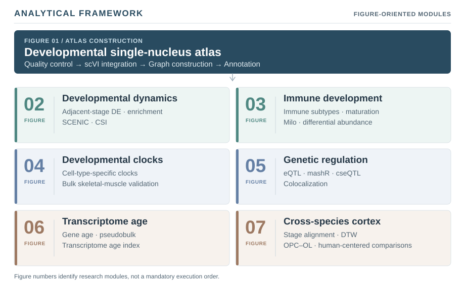

<div align="center">

# DevCellAtlas_Pigs

### A multi-tissue developmental single-nucleus transcriptomic atlas of the pig

*Developmental transcriptomics · Single-nucleus RNA sequencing · Comparative genomics*

<table>
  <tr>
    <td align="center" width="25%"><h2>7</h2>Tissues</td>
    <td align="center" width="25%"><h2>6</h2>Developmental stages</td>
    <td align="center" width="25%"><h2>7</h2>Analysis modules</td>
    <td align="center" width="25%"><h2>snRNA-seq</h2>Primary modality</td>
  </tr>
</table>

[Overview](#overview) · [Workflow](#analysis-workflow) · [Code map](#code-map) · [Getting started](#getting-started) · [Software](#software-and-dependencies) · [Data](#data-availability) · [Citation](#citation-and-license)

</div>

---

## Overview

This repository contains the analysis and figure-generation code for a multi-tissue developmental single-nucleus RNA-sequencing study of the pig (*Sus scrofa*). The study spans embryonic to postnatal development and integrates cell-atlas construction, developmental transcriptional dynamics, immune maturation, transcriptomic clocks, genetic regulation, transcriptome age and cross-species cortical analyses.

<p align="center">
  
</p>

**Tissues:** Adipose · Cerebrum · Duodenum · Heart · Hypothalamus · Liver · Skeletal muscle

**Scope:** Analysis and figure-generation code accompanying the manuscript. Raw sequencing data and large intermediate analysis objects are distributed separately through the public data resources described in the manuscript.

---

## Analysis workflow

<p align="center">
  
</p>

*Figure 1 establishes the atlas foundation; Figures 2–7 represent complementary research modules. Figure numbering is an organizational index rather than a prescribed execution order. Individual analyses may also require bulk, genetic or cross-species inputs.*

---

## Code map

| Module | Scope | Manuscript |
|---|---|---:|
| [`scripts/01_atlas_annotation/`](scripts/01_atlas_annotation/) | Quality control, AnnData construction, scVI integration, graph construction and atlas annotation | **Figure 1** |
| [`scripts/02_developmental_dynamics/`](scripts/02_developmental_dynamics/) | Adjacent-stage differential expression, enrichment, SCENIC and CSI analyses | **Figure 2** |
| [`scripts/03_immune/`](scripts/03_immune/) | Immune-cell integration, subtype programs, maturation modeling and differential abundance | **Figure 3** |
| [`scripts/04_developmental_clock/`](scripts/04_developmental_clock/) | Cell-type-specific developmental clocks and bulk skeletal-muscle validation | **Figure 4** |
| [`scripts/05_bulk_eqtl/`](scripts/05_bulk_eqtl/) | Bulk, interaction and cell-type-resolved eQTL analyses, mashR and colocalization | **Figure 5** |
| [`scripts/06_transcriptome_age/`](scripts/06_transcriptome_age/) | Gene-age assignment, pseudobulk expression processing and transcriptome age index analyses | **Figure 6** |
| [`scripts/07_cross_species/`](scripts/07_cross_species/) | Cross-species integration, developmental-stage alignment, OPC–OL trajectories and human-centered comparisons | **Figure 7** |
| [`figures/`](figures/) | Main and supplementary figure-generation scripts | Figures & Supplementary Figures |

Scripts within each analysis directory are numbered according to their intended logical or execution order where dependencies exist.

---

## Getting started

Clone the repository:

```bash
git clone https://github.com/zane-zwang/DevCellAtlas_Pigs.git
cd DevCellAtlas_Pigs
```

Select the analysis module corresponding to the figure or biological question of interest using the [code map](#code-map). Inspect its scripts for required inputs, paths and package dependencies before execution. Obtain the relevant datasets and external resources described in the manuscript, configure paths for the local environment, and follow the script order where dependencies exist.

The repository is organized as manuscript-associated analysis code rather than a single end-to-end executable pipeline.

<details>
<summary>Repository layout</summary>

```text
DevCellAtlas_Pigs/
├── assets/                      # README visual assets
├── scripts/
│   ├── 01_atlas_annotation/
│   ├── 02_developmental_dynamics/
│   ├── 03_immune/
│   ├── 04_developmental_clock/
│   ├── 05_bulk_eqtl/
│   ├── 06_transcriptome_age/
│   └── 07_cross_species/
├── figures/                     # Figure-generation scripts
├── README.md
└── LICENSE
```

</details>

---

## Software and dependencies

Analyses were implemented in **R**, **Python** and **Bash** using established tools for single-cell genomics, statistical genetics and comparative transcriptomics.

| Analysis area | Major software |
|---|---|
| Single-cell analysis and integration | `Seurat` · `Scanpy` · `scVI-tools` |
| Differential expression and regulatory programs | `edgeR` · `pySCENIC` |
| Differential abundance and trajectories | `Milo` · `Slingshot` |
| Developmental clocks | `glmnet` |
| Statistical genetics and deconvolution | `OmiGA` · `mashR` · `Bisque/bMIND` |
| Transcriptome evolution and comparative genomics | `GenEra` · `DIAMOND` · `myTAI` · `CAMEX` |

Exact package requirements vary by analysis module and are specified by the imports, libraries and command-line tools used in the corresponding scripts. Software versions reported in the manuscript Methods should be used where applicable.

---

## Data availability

Raw sequencing data, processed datasets and large intermediate analysis objects are not hosted in this repository.

Data accession information is provided in the accompanying manuscript and associated public repositories. Some analyses additionally require external reference resources, genome annotations, cisTarget databases or third-party QTL utilities.

---

## Figure generation

Code used to generate the main and supplementary figure panels is provided under [`figures/`](figures/).

Final multi-panel assembly and graphical layout were performed separately from the analysis scripts.

---

## Citation and license

If you use this repository or adapt the accompanying analysis code, please cite the associated manuscript.

> Citation details will be added upon publication.

See [LICENSE](LICENSE) for the repository's licensing terms.

---

<div align="center">

**DevCellAtlas_Pigs**

*Developmental transcriptomics · Single-nucleus RNA-seq · Pig · Statistical genetics · Cross-species genomics*

</div>
