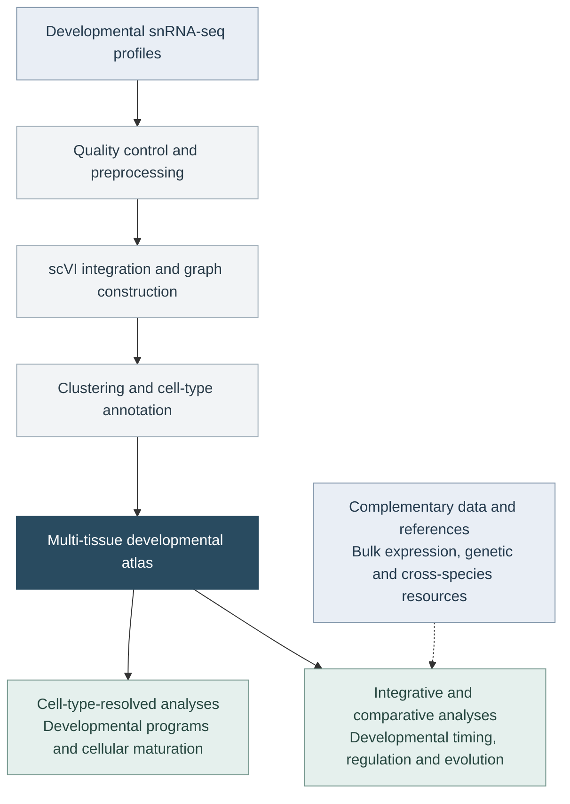

# DevCellAtlas_Pigs

### A multi-tissue developmental single-nucleus transcriptomic atlas of the pig

*Analysis code accompanying a developmental atlas of* ***Sus scrofa*** *across tissues, cell types and developmental stages.*

[Overview](#overview) · [Workflow](#analysis-workflow) · [Code map](#code-map) · [Software](#software) · [Data](#data-availability) · [Citation](#citation-and-license)

---

## Overview

This repository contains the analysis and figure-generation code for a multi-tissue developmental single-nucleus RNA-sequencing study of the pig (*Sus scrofa*), spanning embryonic to postnatal development. The study investigates developmental transcriptional dynamics, immune maturation, transcriptomic clocks, genetic regulation, transcriptome age and cross-species cortical development.

**7 tissues · 6 developmental stages · Single-nucleus RNA sequencing**

Adipose · Cerebrum · Duodenum · Heart · Hypothalamus · Liver · Skeletal muscle

**Embryonic** &nbsp; E55 · E90 &nbsp;&nbsp; | &nbsp;&nbsp; **Postnatal** &nbsp; P0 · P30 · P90 · P180

The repository serves as a companion to the manuscript and an archive of the associated analysis and figure-generation code, rather than a standalone executable pipeline.

## Analysis workflow

*The workflow summarizes the shared atlas foundation and broad analytical directions. Downstream analyses are complementary rather than sequential; additional inputs are used where appropriate.*

## Code map

Analysis scripts are organized by their corresponding main figures in the manuscript.

1. **Figure 1 — [Atlas construction and annotation](scripts/01_atlas_annotation/)**  
   Quality control, AnnData construction, scVI integration, graph construction and atlas annotation.
2. **Figure 2 — [Developmental dynamics](scripts/02_developmental_dynamics/)**  
   Adjacent-stage differential expression, enrichment, SCENIC and CSI analyses.
3. **Figure 3 — [Immune development](scripts/03_immune/)**  
   Immune-cell integration, subtype programs, maturation modeling and differential abundance.
4. **Figure 4 — [Developmental clocks](scripts/04_developmental_clock/)**  
   Cell-type-specific developmental clocks and bulk skeletal-muscle validation.
5. **Figure 5 — [Developmental genetic regulation](scripts/05_bulk_eqtl/)**  
   Bulk, interaction and cell-type-resolved eQTL analyses, mashR and colocalization.
6. **Figure 6 — [Transcriptome age](scripts/06_transcriptome_age/)**  
   Gene-age assignment, pseudobulk expression processing and transcriptome age index analyses.
7. **Figure 7 — [Cross-species cortical development](scripts/07_cross_species/)**  
   Cross-species integration, developmental-stage alignment, OPC–OL trajectories and human-centered comparisons.

Scripts within each analysis directory are numbered according to their intended logical or execution order where dependencies exist.

**Figure generation.** Scripts for the main and supplementary figures are provided under [`figures/`](figures/). Final multi-panel assembly and graphical layout were performed separately.

## Software

Analyses were implemented in **R**, **Python** and **Bash**. Major software components include:

**Single-cell genomics and regulatory analysis** — Seurat, Scanpy, scVI-tools, edgeR, pySCENIC, Milo, Slingshot.  
**Statistical modeling and genetics** — glmnet, OmiGA, mashR, Bisque/bMIND.  
**Evolutionary and comparative genomics** — GenEra, DIAMOND, myTAI, CAMEX.

Software requirements vary by analysis module. Refer to the corresponding scripts and the manuscript Methods for implementation details and reported versions.

## Data availability

Raw sequencing data, processed datasets and large intermediate analysis objects are not hosted in this repository. Data accession information is provided in the accompanying manuscript and associated public repositories.

Some analyses additionally require external reference resources, genome annotations, cisTarget databases or third-party QTL utilities.

## Citation and license

If you use this repository or adapt the accompanying analysis code, please cite the associated manuscript.

> Citation details will be added upon publication.

See [LICENSE](LICENSE) for the repository's licensing terms.
