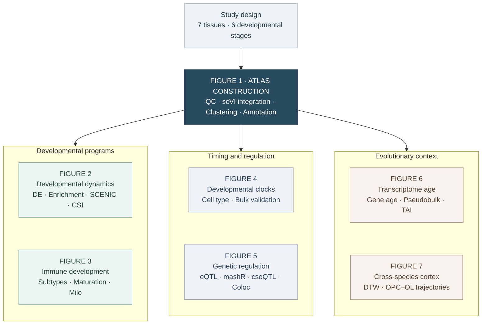

<div align="center">

# DevCellAtlas_Pigs

### A multi-tissue developmental single-nucleus transcriptomic atlas of the pig

*Analysis and figure-generation code accompanying a developmental atlas of* ***Sus scrofa***.

[Overview](#overview) · [Workflow](#analysis-workflow) · [Code map](#code-map) · [Software](#software) · [Data](#data-availability) · [Citation](#citation-and-license)

</div>

---

## Overview

This repository contains the analysis and figure-generation code for a multi-tissue developmental single-nucleus RNA-sequencing study of the pig (*Sus scrofa*). The study spans embryonic to postnatal development and investigates developmental transcriptional dynamics, immune maturation, transcriptomic clocks, genetic regulation, transcriptome age and cross-species cortical development.

| Study design | Description |
|:---|:---|
| **Species** | *Sus scrofa* |
| **Tissues (7)** | Adipose · Cerebrum · Duodenum · Heart · Hypothalamus · Liver · Skeletal muscle |
| **Embryonic stages** | E55 · E90 |
| **Postnatal stages** | P0 · P30 · P90 · P180 |
| **Modality** | Single-nucleus RNA sequencing (snRNA-seq) |

The repository serves as a companion to the manuscript and an archive of the associated analysis code, rather than a standalone executable pipeline. Data and large intermediate objects are distributed separately.

---

## Analysis workflow



*Figure 1 provides the atlas foundation; Figures 2–7 represent complementary research modules, not a prescribed execution sequence. Individual analyses may also require bulk, genetic or cross-species inputs.*

---

## Code map

| Module | Scope | Manuscript |
|---|---|---:|
| [01 · Atlas construction](scripts/01_atlas_annotation/) | Quality control, AnnData construction, scVI integration, graph construction and atlas annotation | **Figure 1** |
| [02 · Developmental dynamics](scripts/02_developmental_dynamics/) | Adjacent-stage differential expression, enrichment, SCENIC and CSI analyses | **Figure 2** |
| [03 · Immune development](scripts/03_immune/) | Immune-cell integration, subtype programs, maturation modeling and differential abundance | **Figure 3** |
| [04 · Developmental clocks](scripts/04_developmental_clock/) | Cell-type-specific developmental clocks and bulk skeletal-muscle validation | **Figure 4** |
| [05 · Developmental genetic regulation](scripts/05_bulk_eqtl/) | Bulk, interaction and cell-type-resolved eQTL analyses, mashR and colocalization | **Figure 5** |
| [06 · Transcriptome age](scripts/06_transcriptome_age/) | Gene-age assignment, pseudobulk expression processing and transcriptome age index analyses | **Figure 6** |
| [07 · Cross-species cortex](scripts/07_cross_species/) | Cross-species integration, developmental-stage alignment, OPC–OL trajectories and human-centered comparisons | **Figure 7** |
| [Figure generation](figures/) | Main and supplementary figure-generation scripts | Figures & Supplementary Figures |

Scripts within each analysis directory are numbered according to their intended logical or execution order where dependencies exist.

<details>
<summary>Repository layout</summary>

```text
DevCellAtlas_Pigs/
├── scripts/
│   ├── 01_atlas_annotation/
│   ├── 02_developmental_dynamics/
│   ├── 03_immune/
│   ├── 04_developmental_clock/
│   ├── 05_bulk_eqtl/
│   ├── 06_transcriptome_age/
│   └── 07_cross_species/
├── figures/
├── README.md
└── LICENSE
```

</details>

---

## Software

Analyses were implemented in **R**, **Python** and **Bash** using established tools for single-cell genomics, statistical genetics and comparative transcriptomics.

| Analysis area | Major software |
|---|---|
| Single-cell analysis and integration | `Seurat` · `Scanpy` · `scVI-tools` |
| Differential expression and regulatory programs | `edgeR` · `pySCENIC` |
| Differential abundance and trajectories | `Milo` · `Slingshot` |
| Developmental clocks | `glmnet` |
| Statistical genetics and deconvolution | `OmiGA` · `mashR` · `Bisque/bMIND` |
| Transcriptome evolution and comparative genomics | `GenEra` · `DIAMOND` · `myTAI` · `CAMEX` |

Exact package requirements vary by analysis module and are specified by the imports, libraries and command-line tools used in the corresponding scripts. Software versions reported in the manuscript Methods should be used where applicable.

---

## Data availability

Raw sequencing data, processed datasets and large intermediate analysis objects are not hosted in this repository.

Data accession information is provided in the accompanying manuscript and associated public repositories. Some analyses additionally require external reference resources, genome annotations, cisTarget databases or third-party QTL utilities.

---

## Figure generation

Code used to generate the main and supplementary figure panels is provided under [`figures/`](figures/).

Final multi-panel assembly and graphical layout were performed separately from the analysis scripts.

---

## Citation and license

If you use this repository or adapt the accompanying analysis code, please cite the associated manuscript.

> Citation details will be added upon publication.

See [LICENSE](LICENSE) for the repository's licensing terms.
